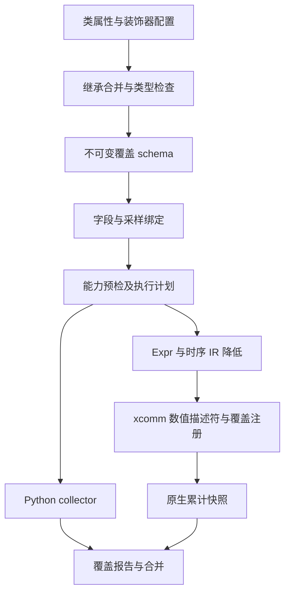

# 类声明覆盖率的 C++ 执行设计草稿

状态：**讨论稿，完整 API 未实现**。2026-10-08。类与装饰器负责可读的定义，覆盖编译器把声明降低到现有 xcomm 引擎；高频信号覆盖优先使用 native 整组计数。Enum 完全可选，首轮强类型 native 输入聚焦 `int/bool`。

现有 XReactor 已实现 native bins、Cross、相邻转移及 Execution 生命周期。本目录的 [native_probe.py](native_probe.py) 是可运行的最小声明编译探针，复用这些实现。[native_usage.py](native_usage.py) 和 [api.pyi](api.pyi) 表达完整候选接口，仍仅用于静态检查。所有文件独立保存在草稿目录。

## 1. 性能目标与执行方式

主要收益来自把连续采样、匹配、历史推进和计数留在 C++，让仿真可以批量推进。Python 只在启动时提交定义，在报告、检查点和退出时读取累计快照。逐次命中不应创建 Python 事件、回调或重新注册。

这里的编译是构造并降低 IR，交给已经构建好的 C++ 引擎执行；不为每个 covergroup 生成 C++ 源文件，不调用编译器构建动态库，也不实现 Python 到机器码的 JIT。现有 C++ Expr/Sequence/FSM 及 coverage ABI 是首轮目标。

Python observer 已经生成的稀疏事务继续直接 sample。若先在 Python 逐拍构造对象，再逐拍跨 FFI 把它交给 C++，仍保留主要交互开销；本轮不把这种方式作为 native 快路径。批量导入事务可以以后单独测量收益。

## 2. 用户接口与装饰器

完整声明示例见 [native_usage.py](native_usage.py)：`StatePoint(CoverPoint[int])` 和 `TakenPoint(CoverPoint[bool])` 组合成一个 group，不需要业务 Enum。实例绑定采用字段引用：

```python
fields = Fields(PipelineSample)
coverage = PipelineCoverage(instance="kunminghu_v3.bpu.pipeline")
coverage.bind(
    trigger=RisingEdge(clock),
    fields=(
        wire(fields.select(lambda s: s.state), dut.state),
        wire(fields.select(lambda s: s.taken), dut.taken),
    ),
    strategy="native",
)
plan = coverage.plan(backend)
```

`wire` 只是不可变配置值。它不读取信号、不注册 watcher、不创建新的生命周期组件。`bind()` 返回原 group，Execution 继续拥有启动、同步和注销。原始 XData 和 Trigger 来自已有 API，其运行时类型、所属 clock 及能力在预检时验证；stub 的 `object` 边界不能静态证明它们合法。

`@coverpoint` 和 `@covergroup` 保留原类，配置描述、策略和 schema 身份。基类提供泛型与公共方法，descriptor 提供声明引用和实例统计访问。装饰器配置完成前不能冻结编译结果；完整编译推迟到 `compile()`、`plan()` 或首次实例化。

`CoverageFragment[S]` 是明确的声明片段，可用 mixin 组织字段和 points。完整编译器要求片段样本类型一致，独立来源的同名声明必须显式处理；同一个祖先声明经菱形继承到达时只收集一次。派生类替换 point 后，继承 Cross 通过最终槽位重新绑定。最小运行探针只验证单继承，未实现这套片段冲突检查。

参数化构建在定义阶段完成，参数值进入 schema。普通 Python 子类覆盖常量不会重算基类中已经调用的 Bin 工厂；首轮要求显式覆盖 bin，不对普通继承赋予隐式重新执行类体的语义。

## 3. 编译阶段



### 3.1 声明编译

收集最终 point/bin/cross 槽位、字段路径、gate、阈值和来源位置。完成类型检查、继承覆盖、引用归属、normal-bin 资格和 Cross 容量检查，再生成 `CoverGroupDef / CoverPointDef / CrossDef`。自动 Cross 在生成笛卡尔积之前检查 4096 上限；显式 include 走已有校验。

最终 schema 按确定的名称和维度顺序规范化。点、桶和 Cross 的声明身份先解析成逻辑位置，不用 matcher 结构相等性合并声明。审核界面可以显示展开后的 bins、实际绑定和来源位置；运行时只使用编译结果。

### 3.2 绑定编译

同名绑定及 `Fields.select` 生成字段提取计划。时钟绑定把实际使用的 point/gate 字段映射到 XData，并记录位宽、数值表示、采样阶段和稳定来源身份。检查缺失/重复绑定、错误根样本、错误 clock 和未支持的转换。

手动 sample 验证真实 dataclass 字段。native 不逐拍构造 dataclass：声明中的样本类型表达逻辑字段契约，物理表示在绑定时验证。未用于 point 或 gate 的辅助字段无需 native 绑定；不能因此在 native 路径执行完整 Python 样本构造。

### 3.3 能力预检

`plan(backend)` 检查 ABI、输入表示、IR 节点、采样源及所需操作。它不分配原生 watcher，不返回可跨引擎复用的 root ID。计划解释目标后端及回退原因；启动时重新检查环境和冻结的绑定，不能使用过期预检结果。

定义错误始终失败，例如缺字段、错误 bin 类型、无关 group 引用和非法 Cross。只有合法定义遇到后端能力不足时才允许 `auto` 回退。能力诊断应包含稳定的 code、point/bin 路径及具体原因。

### 3.4 原生降低与注册

| 定义 | 当前降低方式 | 统计含义 |
| --- | --- | --- |
| values | 相等比较的组合 | 每个有效 sample 分类 |
| range/ranges | 上下界比较的组合 | 保留原整数边界 |
| masked | 原生宽掩码比较节点 | 不截断高位 |
| transition | `Wait` 加相邻 `Next` 步骤 | 完成时累计，历史每实例独立 |
| Iff | 字段比较及取反 | 依赖 X/Z 时不能变成有效 gate |
| Cross | point ID 与 normal-bin ID 的组合 | 只使用同一 sample 的命中集 |

降低复用 [现有 collector](../../../src/xreactor/_coverage_runtime.py) 和 [backend IR 编译](../../../src/xreactor/backend.py)。完整实现需要把内部预检与发射逻辑整理成可复用阶段，不能在草稿中另建语义不同的匹配器。

现有 ABI v3 使用 `XCoverageItem / XCoverageBin` 数值描述符，`AttachCoverage` 把整组定义附到注册 handle。普通命中持续累计；`CoverageSnapshot / ResetCoverage / Disarm` 管理快照、历史和资源。`at_least`、goal 和 weight 保留在 Python schema，用原始计数计算覆盖率，当前 ABI 不需要逐周期传这些参数。

## 4. 输入类型与首轮能力

| 输入或规则 | 首轮候选处理 |
| --- | --- |
| `CoverPoint[int]` 加无符号 XData | native；支持现有完整位宽 |
| `CoverPoint[bool]` 加单 bit XData | native；0/1 是明确的物理表示 |
| bool 字段绑定多 bit XData | 拒绝绑定，不能用任意非零值隐式转 bool |
| 有符号数及负数 matcher 常量 | 当前 native adapter 不支持；合法整数模型可整组 Python 回退 |
| Python transaction 的 str 或 Enum 字段 | 保留手动 sample |
| 强类型 Enum 字段直接绑定信号 | 延后；需要明确解码及非法编码处理 |
| 普通 Expr/Sequence/FSM 采样源 | 使用已有编译 Trigger |
| Python predicate 采样源 | Python；严格 native 拒绝 |
| 任意 Python extractor 或方法重写 matcher | 不自动编译；显式 observer 或后续扩展 |
| 算术表达式作为 point 来源 | 当前 ABI 要求直接 XData，后续另行设计 |

已有低层 API 可以把 Enum 常量归一化成整数，但强类型前端还有不同的约束：信号可能出现不属于 Enum 的编码，而一个合法 Enum 样本无法表达它。不能不加说明地让 native 把这些编码记成 default/unmatched，同时让 Python 抛类型错误。首轮 native 使用 `int/bool`，避免依赖未经定义的枚举解码。

依赖信号的任意位 X/Z，包括 mask 不关心位，继续按现有 point unknown 规则处理并断开相邻转移历史。编译期常量折叠必须保留未知依赖和统计语义。无符号域中不可达的负数规则可以成为以后优化的对象，首轮沿用当前 adapter 的拒绝行为，不把未经差分验证的折叠视为已有能力。

若缺少字段表示转换，`auto` 也不能自动创造转换。例如把 XData 当作字符串或完整 Enum 字段并不是普通后端能力回退；需要先有合法的逻辑字段绑定。

## 5. 后端选择与采样含义

| 策略 | 行为 |
| --- | --- |
| native | 整组满足能力才启动，否则在启动前失败 |
| python | 按同一采样契约在 Python 执行 |
| auto | 优先 native，能力不足时整组 Python 回退并公开原因 |

分组是编译和回退单位。首轮不允许同一个 Cross 的两端分别在 Python 和 C++ 计数，不在运行中自动切换后端，也不因个别命中创建 Python 回调。

XTrigger 描述何时采样，coverpoint 描述值和分桶。持续三拍的值 bin 可命中三次，`enter` 条件只在进入时触发一次，时序模式在完成时计数。不能把每个 bin 注册成默认 enter Trigger，再期待获得逐 sample 计数。

复用的是不可变 Expr/Sequence/FSM 和求值语义，Trigger 通知与 coverage count sink 各自保存注册状态。当前 transition bin 支持相邻值序列；复杂 Sequence/FSM 已能作为整组采样源。让每个 bin 使用任意复杂模式仍需另外规定完成时刻、取值和 Cross 关联。

## 6. 输入契约与缓存

保留已有 `schema_digest` 和候选 `input_digest`。native 绑定增加 `binding_digest`，涵盖逻辑字段、物理位宽、bool 表示、稳定 source_id 以及可序列化的采样配置。适配层将这些指纹和用户语义 contract 组合，交给现有 sampling_contract 检查。

`source_id` 优先取生成 DUT 的稳定端口元数据，也可通过 `wire(..., source_id=...)` 显式提供。不能使用内存地址或引擎 root ID。缺少稳定端口身份时必须显式声明版本化的项目 contract，并在计划中说明来源身份不透明；该 contract 不能自动证明项目没有换绑信号。native 与 Python 的执行选择不应改变同一观测契约的身份。

两层缓存需要分开：纯声明 schema 可以按类、参数和语义指纹缓存；绑定后的原生 roots/handles 只能在对应 backend、clock、信号和 Execution 上下文中使用。相同 schema 不代表可以把 engine A 的数值 ID 带到 engine B。缓存定义不缓存计数和未完成历史。

## 7. 生命周期与异常

完整前端必须向当前 Execution 提供兼容的 `CoverGroup` 运行实例。建议声明基类复用现有 runtime 的实例身份和计数存储，避免双份运行状态；typed `bind` 只负责把 wire 配置降低到当前 API。现有 Execution 检查实际 CoverGroup 类型，不能把任意 facade 直接传进去并宣称已经兼容。最小探针直接返回现有 runtime，已走通这条边界。

预检成功后再注册。启动失败清理本组 handle，不影响已启动的其他组；已分配表达式由 backend/Execution 上下文管理，不能清空整个引擎来处理一组失败。运行中不重新编译定义或换绑信号。

默认每次 Execution 清空计数，`accumulate=True` 保留已完成计数，所有模式都清除未完成历史。退出同步末次累计快照，再释放 handle。重复 snapshot 不能重复加计数。报告同步遵守当前线程约束；普通 native provenance 不增加逐命中 Python 记录。

无效输入在提交前失败，illegal 命中按现有策略提交后报错或记录。容量耗尽、计数溢出和不完整采集必须显式失败或标记，不能截断数据来维持表面吞吐。

## 8. 已运行的独立探针

`native_probe.py` 包含一个最小收集器和无 Enum 的模型。它只收集具名 bins、单继承、point 覆盖及简单 Cross 引用。类型域强校验、Fields selector、片段冲突、装饰器完整配置和 `plan()` 尚未由它实现；它也不实现新的匹配算法或调度器。

2026-10-08 使用 Python 3.12.3 与本机已有隔离构建的 xcomm ABI v3 完成：

- 类声明编译结果与独立手写 schema 完全一致。
- 基类、派生类各 11 个样本，手动 sample、Python 时钟采样、native 时钟采样的统计一致。
- 比较包含 values、range、mask、128 位 payload、transition、Cross、default、ignore、record illegal 和阈值对应的报告结果。
- 派生 point 增加 bin 后，继承 Cross 包含新组合，基类 schema 不改变。
- 重复快照不增加计数，Execution 退出没有残留注册。
- 负数常量使严格 native 在启动时拒绝，auto 整组回退并记录原因，回退统计与手动参考一致。

这里比较统计、schema 与非法值，未要求不同执行路径的 run identity、provenance 和 backend 元数据相同。探针不验证完整前端，也未覆盖 X/Z、重置、gate、并发模式等全部边界；这些继续属于正式实现的差分验收。

复现命令需要可用的 ABI v3 binding。下例使用本机已存在的构建，没有重建或修改 xcomm：

```bash
PYTHONPATH=/tmp/xreactor-coverage-native-build/python \
  python3 design/drafts/class-coverage/native_probe.py

PYTHONPATH=/tmp/xreactor-coverage-native-build/python \
  python3 design/drafts/class-coverage/native_probe.py \
  --benchmark --cycles 10000 --repeats 3 --json \
  > /tmp/xreactor-class-coverage-native-results.json
```

## 9. 微基准与性能验收

相同无 RTL XClock、固定信号、3 points、1 Cross，包含相邻转移和 128 位匹配。每种模式 10,000 周期、3 轮，轮换顺序并先热身；报告周期中位数。计时包含 Execution 启停和末次同步，不包含建 clock/backend、schema 收集及最终报告格式化。批量实验使用 1 秒 wall-clock quantum，不是生产默认设置。

| 路径 | 中位数 ns/cycle | 每轮 RunUntil 返回次数 |
| --- | ---: | --- |
| 无 coverage | 801 | 1 / 1 / 1 |
| Python 时钟采样 | 146,030 | 10,000 / 10,000 / 10,000 |
| 手写 schema 的 native | 2,907 | 1 / 1 / 1 |
| 类编译 schema 的 native | 2,907 | 1 / 1 / 1 |

类 schema 收集本次约 0.250 ms，是单次冷启动测量。两个 native 路径使用相同 schema 与现有计数引擎，测得的周期成本接近；三轮不足以建立很小差异的统计结论。native 与 Python 约 50 倍的差距属于这个微基准，不能作为真实 DUT 的整体加速承诺。XClock 的模拟 eval 回调和已有 Python Driver 往返仍可能存在。

原始 JSON 仅保存在 `/tmp`，不作为设计文件提交。更早的原生采集测量见[既有评审](../../verification/native-coverage-2026-09.md)，数值和范围与本轮分开。

正式验收要求：

1. 对相同 trace 差分验证计数、分母、gate、unknown、illegal、Cross、历史和容量行为，先确认语义再比较耗时。
2. 使用相同 schema 与绑定比较手写/native 类声明路径；普通命中不能增加 Python 回调或 RunUntil 返回。
3. 分开测量声明编译、原生注册、热态采样、snapshot、注销和峰值内存；大规模 bins/Cross 单独测量。
4. 连续运行、reset、clear_history、accumulate、取消和启动失败均验证隔离及资源清理。
5. 真实 BPU 场景比较无覆盖、Python、native 三种运行，固定 seed、RTL 和驱动方式，报告整体吞吐与覆盖开销。
6. 性能回归阈值在稳定环境、多轮结果和真实 DUT 基线形成后冻结；首轮先采用禁止逐样本 Python 交互的结构性要求。

C++ 执行仍有表达式数量、位宽和时序活跃实例成本。现有 native values 通常降低为比较组合，并非自动获得 Python 字典一样的查表复杂度；大量精确 bins 的专用 native 索引可以依据后续测量优化。

## 10. 实施顺序

先实现类收集、装饰器配置、确定性 schema 和单继承；然后接入 wire/类型表示预检与现有 native adapter，完成整组选择和计划解释；最后扩展片段组合及编辑器体验，补齐端到端差分与性能验收。

首轮使用现有 ABI v3，不要求改 C++ 引擎。表达式 point 来源、强类型 Enum 解码和任意 pattern bins 只有在语义明确、现有 ABI 无法表达且测量支持时，才进入后续 ABI 扩展。独立探针证明基础路线可行，不代表完整声明 API 已交付。
